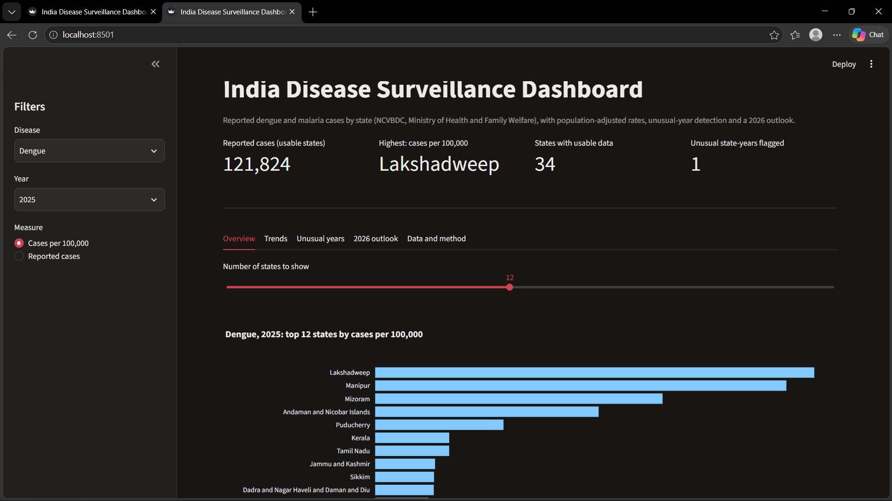

# India Disease Surveillance Dashboard

An interactive dashboard of reported **dengue and malaria cases across Indian states**, with
population-adjusted rates, unusual-year detection and a 2026 outlook.
Built with Python, pandas, scikit-learn, Plotly and Streamlit.



## Project question
Which Indian states show unusual dengue and malaria activity compared with their own history
and with other states, and what is the likely level next year?

## What it does
- Extracts state-wise tables from NCVBDC PDFs and **validates them against the official India totals**
- Cleans state names and flags untrustworthy rows (partial or unreported years)
- Converts counts to **cases per 100,000 people** using government population projections
- Forecasts next year with a simple model and **tests it against "same as last year"**
- Flags unusual state-years and shows a 2026 outlook with an 80% range

## Data
| Data | Source | Years used |
|---|---|---|
| Dengue cases by state | NCVBDC, Ministry of Health and Family Welfare | 2021-2025 |
| Malaria cases and tests by state | NCVBDC | 2022-2025 |
| Population | National Commission on Population, projections 2011-2036 (Table 21) | 2021 and 2026, with 2022-2025 estimated |

Details and known data problems are in [docs/data_sources.md](docs/data_sources.md).

## Method
- **Model:** `log(cases) = a + b * log(last year's cases)`, fitted on all states together
  (about 137 dengue and 108 malaria examples, instead of 4 per state).
- **Evaluation:** rolling backtest. Each test year is predicted using only earlier years.
- **Anomalies:** a state-year is flagged if it is at least 2 typical errors from the expected value
  and has at least 50 cases.

| Disease | Result of the backtest | Method used |
|---|---|---|
| Dengue | Model beat the baseline in 2 of 3 tests (one by a hair) | Regression model |
| Malaria | Baseline beat the model in both tests | "Same as last year" |

## Findings
1. Adjusting for population changes the ranking of states (e.g. Lakshadweep is 30th for dengue by count but 1st per 100,000 in 2025).
2. Large percentage jumps come from tiny starting counts, so the model works on log(cases).
3. National totals are affected by reporting: malaria tests rose about 29% (2022-2025) while cases rose about 33%; dengue fell about 48% in 2025, but West Bengal's 2025 figure was not reported.
4. Small territories dominate the dengue rate map, and Mizoram dominates malaria (about 740 per 100,000 in 2025).
5. Four malaria states (Assam, Haryana, Punjab, Uttarakhand) were flagged high in 2024. Testing barely changed in three of them while cases rose 5-10 times, so it is not a testing artifact. The cause cannot be determined from this data.

## How to run
```
git clone https://github.com/Rishlin/india-disease-surveillance.git
cd india-disease-surveillance
python -m venv .venv
.\.venv\Scripts\Activate.ps1
python -m pip install -r requirements.txt
python -m streamlit run app.py
```
The processed data is included, so the app runs straight away.

To rebuild everything from the original PDFs:
```
python src/extract_tables.py
python src/data_loader.py
python src/population.py
python src/models.py
python src/anomalies.py
```
Run the checks with `python -m pytest -q`.

## Project structure
```
app.py            Streamlit dashboard
src/              extract_tables, data_loader, population, models, anomalies
notebooks/        01_eda.ipynb (exploratory analysis and findings)
data/raw/         original PDFs
data/processed/   cleaned data, forecasts and anomalies
tests/            data checks
docs/             data sources and screenshot
legacy/           first prototype (hard-coded data)
```

## Limitations
- Reported cases under-count the true burden, and testing and reporting change over time.
- Only 4-5 yearly values per state, so the models are deliberately simple.
- Population for 2022-2025 is estimated between the 2021 and 2026 projections.
- Rates for small populations are unstable, so counts are shown beside rates.
- Forecast ranges use one error size for all states, so they are probably too wide for large states.
- The method per disease was chosen from only 5 backtest results.
- Flags and forecasts are decision aids, not diagnoses.

## Author
Fathima, B.Tech Computer Science (Data Science), Amity University.